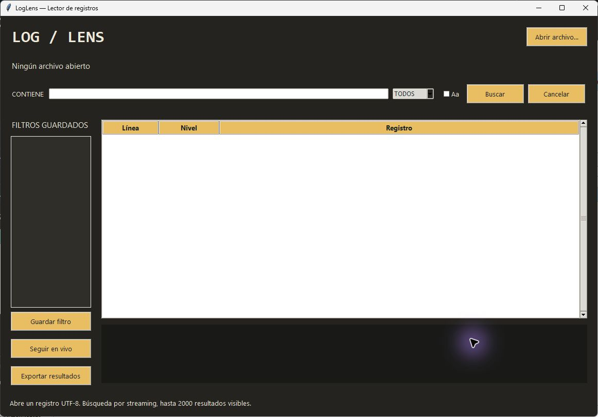

# LogLens

A desktop log reader with streaming search, live tailing and saved filters.

[](https://github.com/MIGUEL-MOSCOSO-DEV/loglens/actions/workflows/ci.yml) · [Descargas](https://github.com/MIGUEL-MOSCOSO-DEV/loglens/releases/latest) · [MIT](LICENSE)

Abre registros grandes, encuentra lo que buscas y sigue nuevas líneas sin cargar todo el archivo en memoria.



## Qué incluye

- Búsqueda literal por streaming, con distinción opcional de mayúsculas y filtro por nivel.
- Reconocimiento de niveles en texto y JSON Lines.
- Seguimiento de líneas nuevas, detección de truncado y rotación por identidad de archivo.
- Filtros guardados y exportación de los resultados visibles a CSV.

## Descargar para Windows

En [Releases](https://github.com/MIGUEL-MOSCOSO-DEV/loglens/releases/latest) encontrarás LogLens.exe y su archivo SHA256SUMS.txt. Es una aplicación portable para Windows 10/11 de 64 bits: no necesita instalar Python ni permisos de administrador. Abre el ejecutable para iniciar. Los ejecutables no tienen firma digital.

## Ejecutar desde el código

Necesitas Python 3.11 o superior con Tkinter. Crea un entorno virtual para mantener las dependencias separadas.

```sh
git clone https://github.com/MIGUEL-MOSCOSO-DEV/loglens.git
cd loglens
python -m venv .venv
```

En Windows:

```powershell
.venv\Scripts\python.exe -m pip install .
.venv\Scripts\python.exe launch.py
```

En Linux o macOS puedes usar .venv/bin/python. Tkinter debe estar disponible en tu instalación de Python; la revisión visual y los ejecutables publicados corresponden a Windows.

## Uso

Abre un archivo de registros UTF-8, escribe un texto y pulsa Buscar. Selecciona una coincidencia para ver su contenido completo. Guardar filtro conserva la búsqueda, nivel y sensibilidad de mayúsculas. Seguir en vivo comienza al final actual del archivo: muestra las nuevas líneas completas que coincidan con el filtro.

## Datos y privacidad

La instalación comienza sin registros de demostración. Los datos locales se guardan en ~/.loglens (la carpeta de tu usuario). Puedes cambiar esa ubicación con la variable LOGLENS_HOME. filters.json conserva los filtros que tú guardes. Los logs originales no se modifican.

## Alcance actual

La búsqueda muestra como máximo 2000 coincidencias; si alcanza el límite, se detiene y lo indica. Las líneas mayores de 256 KB se omiten en búsquedas. El seguimiento lee hasta 1 MB por ciclo y acota líneas grandes; la representación de líneas excesivas puede truncarse. No admite expresiones regulares, archivos comprimidos ni múltiples archivos a la vez. Una rotación con la misma identidad y tamaño creciente entre lecturas puede no detectarse.

## Desarrollo y pruebas

```sh
python -m pip install . -r requirements-dev.txt
python -m ruff check .
python -m ruff format --check .
python -m unittest discover -s tests -v
```

Las pruebas usan directorios y datos temporales. GitHub Actions verifica formato y pruebas en Windows y Linux y construye un ejecutable de Windows como artefacto del workflow. No hay una aplicación web ni un servidor remoto requerido.

## Generar el ejecutable

Desde Windows, con las dependencias de desarrollo instaladas:

```sh
python -m PyInstaller --noconfirm --clean --onefile --windowed --name LogLens launch.py
```

El resultado queda en dist/LogLens.exe. PyInstaller construye para el sistema donde se ejecuta; para generar Windows necesitas construir desde Windows. Los archivos de compilación y los datos locales se excluyen de Git.

## Estructura

reader.py contiene lectura acotada, búsqueda, seguimiento y filtros; app.py ejecuta búsquedas en un hilo con cancelación y muestra resultados.

## Contribuir

Abre un issue con el sistema operativo, la versión y los pasos para reproducir el problema. No incluyas archivos privados, contraseñas ni bases reales. Para cambiar reglas de negocio, añade una prueba que describa el caso.

Creado por [Miguel Moscoso](https://github.com/MIGUEL-MOSCOSO-DEV). Licencia MIT.
